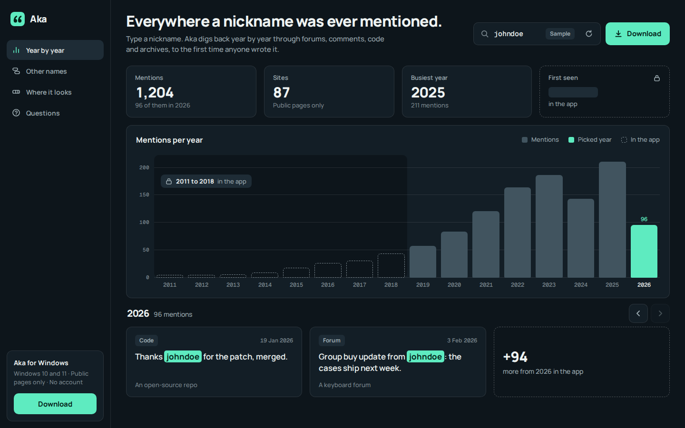
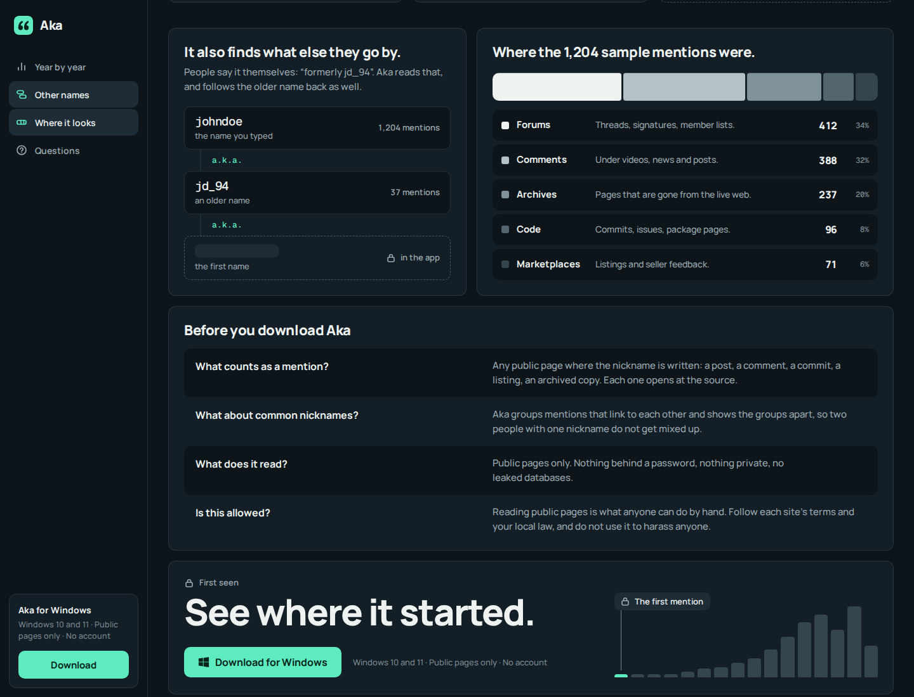
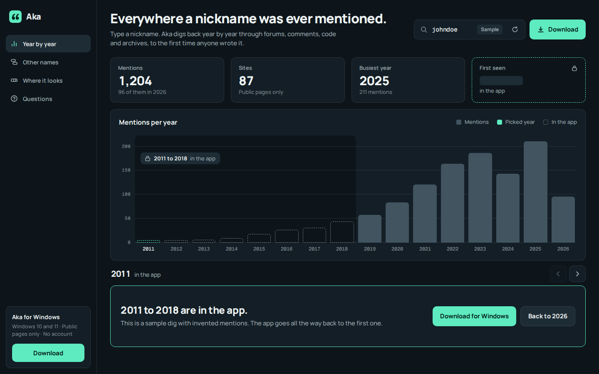

<h1 align="center">Aka: OSINT username search across the public web</h1>

<b>Everywhere a nickname was ever mentioned.</b> Every public mention, year by year, back to the first one.

OSINT · OSINT tool · username search · username OSINT · nickname search · SOCMINT · digital footprint · windows

> **Status: v1.5.4.** The app is out — [download Aka for Windows](https://awesomeosint.tools/aka/).

## Why this exists

People change handles, but they rarely change habits. The first mention is usually the most honest one — before the persona was polished.

## Why it is different

Username search sites list today's hits. Aka walks the years: the same nickname, the archives it lived in, and the other names it went by on the way. The timeline is the answer, not a grid of logos.

## The idea

- **One object.** A quotation mark: a mention is someone else writing the name.
- **One number.** How many public mentions the nickname has, and the year of the first one.
- **Colour.** Deep sea `#0D151B` and white. Mint `#5EEBC0` marks the nickname where it was found, and the download.
- **The main feature.** It digs back in time: mentions are laid out by year down to the first one ever, and when a mention says "formerly …" it follows the older name too.

## The demo on the page

The bars rise from the newest year backwards while the mention count runs up. Any year from 2019 can be clicked: two sample mentions appear with the nickname marked, plus how many more that year has. The first eight years are dashed outlines; clicking one, or "First seen", shows the download instead.

